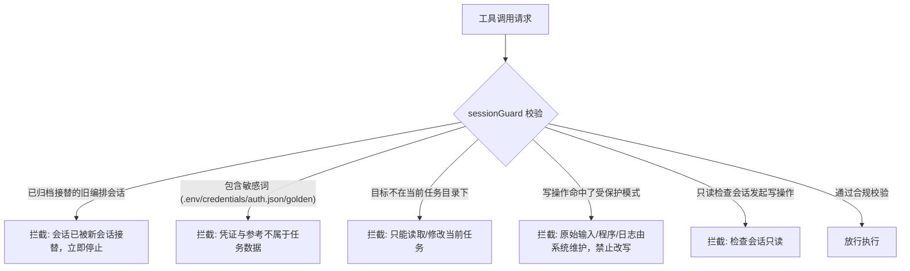
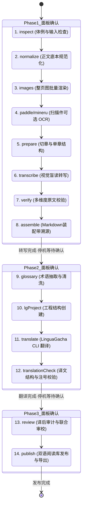

# @local/paper-reader 统一文档流水线完整技术手册与编排指南

本文档依据 `@local/paper-reader` 当前的真实代码实现（`modules/pipeline/`、`runtime/`、`preset.js` 与 `dev-server/`）编写，旨在为开发者、自动化 Agent（编排者）以及系统维护者提供权威、闭环的参考指南。

---

## 目录

1. [系统架构与存储布局](#1-系统架构与存储布局)
2. [多会话模型与角色分工](#2-多会话模型与角色分工)
3. [沙箱安全门禁与权限矩阵 (sessionGuard)](#3-沙箱安全门禁与权限矩阵-sessionguard)
4. [统一编排工具 document_pipeline 动作规范 (Tool Reference)](#4-统一编排工具-document_pipeline-动作规范-tool-reference)
5. [任务生命周期与 15 个受控阶段](#5-任务生命周期与-15-个受控阶段)
6. [排障 SOP：体例分析与阻塞死锁解除](#6-排障-sop体例分析与阻塞死锁解除)
7. [本地预览与基准测试](#7-本地预览与基准测试)

---

## 1. 系统架构与存储布局

本插件承担学术专著（Book）、论文（Paper）、章节抽取（Chapter）以及文章合集（Collection）的端到端受控处理。

### 1.1 存储根与隔离口径

- **阅读工作区根（Reading Workspace）**：
  默认是当前工作区同级的 `papers/` 目录（可由插件配置 `workspace` 参数钉死指定）。
- **任务目录（Task Directory）**：
  位于 `<阅读工作区>/.pipeline/tasks/<taskId>/`，其中 `taskId` 为标准的 36 位 UUIDv4。
- **元数据库（Catalog Database）**：
  位于 `<阅读工作区>/.pipeline/catalog.sqlite`，由 SQLite 本地维护任务索引（`tasks`）、文献元数据（`documents`）以及书签收藏（`item_meta`）。
- **单向只读文献导入（Legacy Import）**：
  历史文献目录（`papers/*.json`、`Book/*`）接入为只读任务，绝不对历史归档进行非幂等修改。

### 1.2 单任务目录内部结构规范

每个文档任务被严格封存在独立的目录空间中：

```text
.pipeline/tasks/<uuid>/
├── task.json                   # 任务核心状态描述符（模型配置、当前阶段、批准回执）
├── sessions.json               # 绑定的三个执行会话身份记录
├── execution-events.jsonl      # 程序运行事件日志（Worker 与 CLI 的标准输入输出镜像）
├── profile.json                # 经校验生效的文档体例与范围配置
├── profile.candidate.json      # 待人工/编排者审核修正的候选配置
├── profile-analysis/           # 初始采样分析产物（requests/ 请求日志、pages/ 采样图）
├── probe-pages/                # 受控探测动态渲染的原页图（page_NNNN.png）
├── ocr-regions/                # 局部 PaddleOCR 结果缓存（按 hash 隔离）
├── document/                   # 规范化底本与切片
│   ├── source.pdf              # 规范化正文底本（仅含确认正文起止范围）
│   ├── document_profile.json   # 页面映射元数据（源页码与逻辑页码对照）
│   └── ai_convert/             # 章节切分与视觉识别中间态
│       ├── chapters.json       # 章节清单与起止页映射
│       ├── page_images/        # 批量整页图像
│       └── delivery/           # 交付章节独立处理工件与报告
└── review/                     # 译后审校与分包审计工件
    └── audit/                  # 分包 manifest、旧修订快照与对账清单
```

---

## 2. 多会话模型与角色分工

为了避免“大模型输出污染执行日志”以及“日志记录触发无关模型二次调用”，本插件为每个任务分配由程序宿主拥有的独立三会话组（Trio）：

| 会话角色 | 标识名称 | 职责定位 | 模型调用特性 |
| :--- | :--- | :--- | :--- |
| **编排者** | `orchestrator` | 主控制台。响应用户指令、检查证据、调用编排工具推进阶段、核查异常并向用户汇报。 | 运行完整 Agent 交互循环，可调用原生工具与 `document_pipeline`。 |
| **后台 Worker** | `worker` | 视觉转写与底层脚本运行日志镜像。 | **不调用模型**。仅将 `bounded_chapter.py`、`analyze_document.py` 等脚本的 stdout/stderr、请求回执以受控格式追加记录。 |
| **LinguaGacha CLI** | `linguagacha` | 官方翻译 CLI 执行监控。 | **不调用模型**。仅单向镜像翻译事件、段落进度与完成统计。 |

> [!IMPORTANT]
> - 外部脚本执行进度（转写、翻译）属于“程序数据”，会自动沉淀至 `worker` 或 `linguagacha` 会话中，不污染 `orchestrator` 的上下文；
> - 当用户在面板勾选“开启新会话”或首次进入 `review` 阶段时，`rotateOrchestrator` 会自动主动中止旧 `orchestrator` 会话的活跃推理轮次并保留 `worker`/`linguagacha` 日志会话；已被接替归档的旧会话若仍有残余调用，会被门禁立即返回终止提示而不再空转重试；
> - 编排者绝不能伪造 Worker 的返回，必须基于实际落盘的证据文件开展判断。

---

## 3. 沙箱安全门禁与权限矩阵 (sessionGuard)

在 `modules/pipeline/guard.js` 中实施了严格的安全门禁，版本为 `2026-10-17.1`。

### 3.1 预设工具白名单

`reading-document` 预设仅允许以下工具：
- `document_pipeline`：统一流水线管理工具；
- `read`：读取任务目录内的文本文件（UTF-8）；
- `read_image`：读取任务目录内的已渲染图像（PNG/JPEG/WebP）；
- `write` / `edit`：受控修改任务特定产物（见可写限制）；
- `subagent`：派发只读结构观察或局部证据核验子代理（禁止派发次级子代理）。

### 3.2 路径读写权限矩阵



- **绝对私密路径（禁止读写）**：
  `.env*`、`.worker_env`、`credentials*`、`private-transports`、`auth.json`、`cookies*`、`config.toml`、`config.json`、`golden`。
- **受保护系统资产（只读，不可直接改写）**：
  - 流水线程序脚本（`*.py`、`*.js`、`*.mjs`、`*.sh`）；
  - 任务核心生命周期文件：`task.json`、`sessions.json`、`execution-events.jsonl`、`state.json`、`profile.json`、`document_profile.json`；
  - 原始底本与批处理源：`source.*`、`raw_pages*`、`page_images/`、`ocr-regions/`、`requests/`、`attempts/`；
  - 审校门禁快照：`review/audit/snapshots.json`、`manifest.json`、`validation.json`。
- **允许 Agent 修复的文件（受审计指纹回执严格约束）**：
  - 章节结构草稿：`chapters.json`、`toc.json`、`profile.candidate.json`；
  - 章节标志位与豁免声明：`delivery/<ch>/selected/book/ai_convert/edits/body/page_NNN.json` 仅允许用 `edit` 修改 `metadata.issues` 豁免项及段落 `continues_from_prev` / `continues_to_next` / `kind` 标志（**严禁手改 `paragraph_summary`**，`verify` 会自动复算并绑定回执；**严禁用 `edit`/`write` 直接改写 `paragraphs[].text`、增删段落、改写页内 `notes_definitions` 或改写 `edits/notes/chapter_NNN.json` 的 `definitions`**——无加密回执的手改必触发 `content/notes hash differs` 阻断，必须调用 `document_pipeline` 的 `source_edit` 或 `note_continuation`）；
  - 术语分析初稿与对账建议。

---

### 3.3 转写、校验与术语翻译异常：现有恢复入口

本节适用于用户已确认的 transcription（转写与校验）及 translation（术语抽取与翻译）阶段。先按具体报错查本表，再核对原页、已验收产物或检查点；证据充分且不改变模型、预算、底本或阶段授权的确定性修复与增量断点恢复，由编排者自行完成，不必重复请用户裁决。首次处理阅读手册；已读且未变时复用，遇到异常只补读相关条目，不重复全文阅读或派发同题诊断。

| 报错或现象 | 现有入口与证据要求 | 操作及验收 |
| :--- | :--- | :--- |
| 单页仅一个长段，`severe under-segmentation` | 目检原页，确认没有内部段落边界；已有 OCR 可辅助核对。字数阈值不能单独证明分段错误。 | 在该页 `metadata.issues` 添加以 `under_segmentation_waived:` 开头的原页取证说明，保留正文。普通自然语言说明或 `under-segmentation check:` 不触发此入口。随后 `run stage=verify`，可用 `chapterId` 限定章节。 |
| `notes hash differs`，当前文件缺少已验收定义 | 对照 `worker_audit.jsonl` 的有效验收记录与 `attempts/` 内对应快照，确认验收快照已包含缺项，并核对其他内容差异。记录和快照只读。 | 若能确定对应的已验收原文件，可将其全文恢复至当前章 `selected/book/ai_convert/edits/notes/chapter_NNN.json`，由 verify 复算哈希。恢复必须保留其他已确认修正；存在无法解释的差异或无法确认有效快照时停止这一恢复操作，报告具体差异，不猜写定义、不改审计哈希。 |
| 页级有定义，章级未收录，且已验收章级快照也缺项 | verify 的现有机械修复会从有有效出处的页级结果采纳逐字相同的定义，并由程序产生回执。 | 先 verify 一次；若仍阻断，报告实际拒绝原因。不要把当前文件缺少已验收定义误判成必须重新生成脚注，也不要直接按所有页级定义覆盖整章 notes。 |
| 篇名扉页与正文开篇重复 H2 | 目检对应原页，区分扉页题名与正文标题。 | 保留全部文字，将扉页题名改为普通文本类型，保留正文标题用于导航；verify 重新组装并检查。不得以去重为由删去原文。 |
| 文档首尾纯出版/宣传副文本页误报 `paratext` 阻断 | 目检对应原页：扫描封面/封底、半扉页/纯书名扉页、版权/ISBN/CIP 页、作者其他著作表（*Du même auteur / Also by*）、出版社丛书介绍与目录、期刊/出版方简介与下载平台封皮允许在文档首尾或前/后附材章以 `regions: ["paratext"]`、`paragraphs: []`、`metadata.issues: ["paratext_omitted: ..."]` 跳过；若位于正文中间被安全护栏阻断，须核对原图确认是否误标。 | 若确为实质正文/前言/致谢/目录/索引/参考文献，重新转写该页；若经原图核实确属插在非边界处的纯出版宣传页，在该页 `metadata.issues` 补充 `paratext_waived: <原图依据>` 后重跑 `verify`。 |
| 跨页段落连续性标志不一致（`continuity mismatch at page X→Y`） | 目检第 X、Y 页原图或核对首尾句语义，确认正文无缺漏、仅为 `continues_to_next` / `continues_from_prev` 布尔标志不配对。 | 用 `edit` 仅修正对应段落的 `continues_from_prev` 或 `continues_to_next` 布尔值（**切勿手改 `paragraph_summary`**），随后运行 `run(stage="verify", options={"chapterId": "NNN"})`，程序会自动复算 `paragraph_summary` 并绑定 `deterministic_summary_v1` 回执。 |
| 跨页脚注续段误入下页正文末尾或注释截断 | 目检上下两页原图（`page_X.png` 与 `page_X+1.png`），确认下页底部小字号无编号续段被误收为下页末尾正文段（或粘连在正文段末）。**切勿在转写阶段无故拆改已通过 `program_checks_passed` 且仅带 `WARNING` 的章节**；对阻断章或确需修复处，严禁用 `edit`/`write` 直接改 `paragraphs[].text` 或 `notes/chapter_NNN.json`。 | ① 若续段位于下页末尾独立段落（如 `p149_3`）：调用 `document_pipeline(action="note_continuation", chapterId="NNN", review={"anchor":"[^p148_2]","source_page":148,"continued_on_page":149,"continuation":"续段全文","body_pids":["p149_3"],"remaining_continues_to_next":true,"basis":"原图核证说明"})`；② 若需修补单段正文文字或章级注释文本：调用 `document_pipeline(action="source_edit", chapterId="NNN", review={"type":"body_text_patch"|"patch"|"marker_correction", ...})` 自动生成 `worker_audit.jsonl` 加密回执。 |
| 英文/拉丁文无 OCR 跨页断词残留空格（如 `honor able` 实为 `honorable`） | 目检跨页原图与上下页 `edits/body/page_NNN.json`，确认属于单页转写去连字符后在跨页拼接处插入了空格。 | 若仍在转写阶段（尚未进入术语分析与翻译）：通过 `document_pipeline(action="source_edit", chapterId="NNN", review={"type":"body_text_patch", ...})` 修补对应段文字后执行 `run(stage="verify")` 与 `run(stage="assemble")`；若已进入审校阶段，则直接通过 `source_corrections` 一并修正。 |
| 章节某页报 `缺少独立视觉或受控 OCR 降级的文件指纹回执`（`unverified_pages` 非空 / `models_exhausted`） | 查看 `evidence` 返回的 `pageBudgets` 与该章 `state.json`：区分「用户刚在面板切换了尚未尝试的新模型」与「当前主/备视觉模型均已尝试失败」。 | ① 若当前任务 `worker`（或 `fallbacks`）包含该页尚未尝试过的新模型：直接调用一次 `run(stage="transcribe")`（程序会自动重开该页预算并仅重跑该页，同时继续跑完后续未启动章节）；② 若当前配置的全部模型均已在该页失败耗尽：**禁止**同模型反复调用 `retryErrors: true`，**严禁**调用 `ocr` 后用 `write` 手造 `page_NNN.json`；应直接停机向用户汇报具体章节、页码与失败原因，引导用户在面板使用「卡住页重试」或「更换转写模型」。 |
| 已通过验收章节（`qualityStatus: "program_checks_passed"`）存在非阻断 `WARNING` | `WARNING`（如单段长页提示、短引文注释提示、疑似未闭合注释提示）不阻断 `transcribe` / `verify` / `assemble`。 | **严禁在转写阶段擅自用 `edit`/`write` 拆改已通过 `program_checks_passed` 章节的正文或注释**（极易破坏已有审计回执）。保持已通过状态直接推进；若确有实质漏字或错位，统一留待 `review`（译后联合审校）阶段通过 `source_corrections` 安全闭环（或仅在确有必要时使用受控 `source_edit` / `note_continuation`）。 |
| `actions` 或 `similarity_report` 尚未清空 | 这些是程序维护的未解决问题记录。 | 修正实际问题后运行 verify，由程序更新或清除；禁止手删记录来通过校验。 |
| `GLOSSARY_RESULT_INVALID` 或术语单元模型输出 JSON 语法残缺（如末尾括号多余、引号未转义、漏冒号或缺少字段） | 核查 `receipt.json` 与 `runs/.../output/`。只要绝大部分单元已成功落盘，且 `providerRetryCount < providerRetryLimit`（上限 3 次）。 | **编排者自主调用断点恢复**：直接执行 `document_pipeline run, stage="translate", options={"retryErrors": true}`。底层 `recoverGlossaryCheckpoint` 会自动将已验证的有效单元冻结入 `checkpoint.json` 予以 100% 复用，仅将残缺或异常的单元提交增量重试（通常仅需数秒）。耗时极短且不属于重复全量计费，**编排者应当自行处理并接续后续流程，不必中断停机向用户请示**。只有 3 次重试耗尽仍失败、或底本哈希变化时才停机报告。 |
| `GLOSSARY_BATCH_INCOMPLETE`（术语批次部分单元超时、截断或跳过；含 CLI 连续 20 分钟无新增完成单元被看门狗停止，`receipt.cliTimedOut=true`，此时退出码可能为 0 且 events 最后一条仍为 running） | 核查 `receipt.cliStats`、`receipt.partialUnitsCaptured` 与 `events.jsonl`，确认部分单元已完成且无致命权限错误；`providerRetryCount < 3`。`receipt.resumeAvailable=true` 即可断点恢复。注意 `partialResumeSupported` 只表示**本次运行**是否从检查点起步（首轮必为 false），不能据此判断下一次 `retryErrors:true` 会全量重跑。 | **编排者自主调用断点恢复**：执行 `document_pipeline run, stage="translate", options={"retryErrors": true}`。程序会自动提取增量未完成单元继续执行，不得误判为全书失败。 |
| `GLOSSARY_PROVIDER_RETRY`（供应商瞬时超时、输出长度截断或内容安全重试） | 核查 `glossaryFailure` 错误原因（`timeout` / `output_limit` / `content_filter`）；`providerRetryCount < 3`。 | 属于受控供应商容错范围。编排者自主执行 `options={"retryErrors": true}` 断点重试，底层自动复用已完成单元，仅重跑受阻部分。 |
| `GLOSSARY_PROVIDER_QUOTA` / `TRANSLATION_PROVIDER_QUOTA`（供应商额度或速率配额耗尽） | 持续命中 `"code":"RATE_LIMIT"`（`rate_limit_error` / `usage limit` / `quota`）且连续 3 分钟无新增完成单元时，程序自动快速中止并保留全部已完成单元（`status: "quota-exhausted"`），**不增加 `providerRetryCount` 重试计数，也不自动切换兜底模型**。 | **立即停止自动重试并向用户原样汇报额度耗尽提示与重置时间线索**。待额度恢复后执行 `run stage="translate", options={"retryErrors": true}` 仅续跑未完成单元；若用户希望更换模型，引导用户在阅读面板重新选择并确认翻译阶段模型。 |
| 审校分包遇到底本转写讹误或 PDF 物理扫描裁切/破损（如 `hints` 含 `source_defect`、边缘缺字或行末断词跨裁切边误拼） | 查阅原文旁 `.source-map.json` 的 `logicalPages`/`pdfPages`，检视 `document/ai_convert/page_images/page_NNN.png` 或调用 `probe_page` 查看原页图像，严格区分「上游转写错误」与「底本图像自身物理残损」。 | ① **原图清晰或可据原图与学界定本确证的转写错误**（如行末 `Krafft-` 跨左缘裁切与 `ing` 误拼为 `Kraffting`）：在对应 `results/编号.json` 顶层写入 `source_corrections: [{"blockId": "Bxxxx", "pages": [页码], "source": "修正后完整原文", "translation": "对应完整译文", "reason": "原图核证依据"}]`；② **底本 PDF 图像自身物理裁切/残损缺字**：严禁将分包挂起为 `status: "needs-work"` 或写入 `unresolved` 要求从残损原图凭空补字（会阻断整书补丁合并）！应基于可见字形与语境稳妥修订译文 `patches`，并在顶层写入 `source_notes: [{"blockId": "Bxxxx", "text": "底本第X页左缘物理裁切说明..."}]`（自动记入审校报告「底本核证说明」），同时设 `status: "pass"`、`unresolved: []`。 |

章节转写完成并写出待核查稿时，程序保留该章阻断，继续处理同一授权阶段内尚未启动的独立章节，全部执行结束后集中报告；未通过章节仍禁止进入整书交付与翻译。底本变更、执行环境故障、缺少出处凭证或用户停止仍终止领取新章节。此机制不增加模型轮次。

`retryErrors:true` 是显式恢复请求，不等于重置预算。在转写阶段，程序仅向已完成但验收待定的章节传入剩余预算页范围，执行器再筛选仍有问题的页；已通过页、达到两轮上限的页及同模型下 `models_exhausted=true` 的页不会因此重派。报告仍将该页标为 BLOCKED、且最近一次尝试已被拒绝（`used>=2`，结果未选定）时，同样不能靠同模型续跑再调用模型。用户在面板通过「卡住页重试」单选模型重试，或通过「更换转写模型」将任务切换至该页尚未尝试过的新视觉模型后，程序会自动重开这些失败/缺回执页并调用新模型（不影响已通过页）。章节已通过程序验收、但该页正文仍是 OCR 兜底（`fallback_applied` 为 `ocr_layout_cleaned`）时，同样支持在面板用新模型替换；已通过且正文来自视觉选定的页不进入。编排者不自行挑选或切换模型。`used=1` 不能单独证明仍可自动重试：主模型与全部兜底耗尽后还受后者限制。在术语分析（`glossary`）阶段，`retryErrors:true` 是纯增量断点恢复指令：底层 `recoverGlossaryCheckpoint` 会自动从已落盘的模型返回中提纯所有合法单元并冻结为检查点（`checkpoint.json`），仅将残缺或未完成的单元重新提交，不重复消耗已完成单元的模型调用。当编排者因个别单元 JSON 解析错误（`GLOSSARY_RESULT_INVALID`）或批次未完成（`GLOSSARY_BATCH_INCOMPLETE`）受阻且 `providerRetryCount < providerRetryLimit` 时，编排者应自主调用 `run stage="translate", options={"retryErrors":true}` 执行断点接续，严禁将其误判为需要用户重新授权或重置全书。`retryErrors:false` 保持复用已有结果。视觉请求失败不等于原页为空白；OCR 透印噪声不得仅删除脚注后放行正文，应保留待核查状态。

验收须覆盖章节组装；前一个错误消失后可能出现此前未执行的 Markdown 检查。只有实际内容、证据或程序发生变化时才重复 verify；结果无变化时继续运行相同校验不能修复问题。`retryErrors:false` 不禁止上述不调用模型的修复。额外模型轮次仍遵守原预算与补救条件，不能作为确定性恢复的默认替代方案。

无法确认原文、缺少可验证快照、需要改变模型/预算/底本或进入尚未授权阶段时，才报告所需决策。编排者不能修改运行源码，不能因此推断不存在恢复入口；先查本节，仍无适用入口时提交明确的程序缺口及证据。调用工具若明确拒绝操作，应报告拒绝原因，不尝试绕过。

---

## 4. 统一编排工具 document_pipeline 动作规范 (Tool Reference)

`document_pipeline` 是编排者推进任务的唯一核心工具，支持通过 `action` 分发不同的受控操作。

### 4.1 动作一览表

| `action` | 适用角色 | 核心功能 | 关键参数 |
| :--- | :--- | :--- | :--- |
| **`task`** | 编排者/观察者 | 读取绑定任务的当前状态、配置、三阶段授权回执及证据路径。 | `taskId`（可选） |
| **`inspect`** | 编排者 | 检查当前工作区的 Python/Node 环境与模型服务状态。 | 无 |
| **`probe_page`** | 编排者/观察者 | **受控 PDF 页面探测**：抽取文本层文本并渲染原页 PNG 图。 | `page` 或 `pages`（1-8 页） |
| **`evidence`** | 编排者/观察者 | 汇总章节交付状态、错误报告、路径定位与预算开销。 | `chapterId`（可选）、`limit`、`offset` |
| **`files`** | 编排者/观察者 | 受控分页浏览任务目录下的物理文件（防路径穿越与凭证泄露）。 | `directory`（相对路径）、`limit`、`offset` |
| **`search`** | 编排者/观察者 | 在任务文本文件中基于关键字查找匹配行与行号（带游标）。 | `file`、`query`、`limit`、`offset` |
| **`ocr`** | 编排者 | 针对指定页面的局部坐标区域调用 PaddleOCR 识别疑点。 | `page`、`region: [l,t,r,b]`、`reason` |
| **`source_edit`** | 仅限编排者 | 目检原页后受控修补章节正文文字（`body_text_patch`）、注号（`marker_correction`）或注释定义（`patch`/`replace_definition`/`merge_definition`），自动绑定 `worker_audit.jsonl` 回执。 | `chapterId`、`review` |
| **`note_continuation`** | 仅限编排者 | 目检跨页原图后将下页末尾误入正文的无编号脚注续段移回对应注释定义，自动重算 `paragraph_summary` 并绑定加密回执。 | `chapterId`、`review` |
| **`run`** | 仅限编排者 | 启动或接续执行当前阶段（受面板确认状态约束）。 | `stage`、`options` |
| **`review_prepare`** | 仅限编排者 | 准备译后分包审计目录与清单（审校阶段）。 | 无 |
| **`review_assemble`**| 仅限编排者 | 汇总并校验分包审计结果、术语合规与注释完整性。 | 无 |
| **`review_apply`**   | 仅限编排者 | 将审校通过的分包补丁应用到最终产物中。 | 无 |
| **`reset_transcription`** | 仅限编排者 | **清空转写记录与交付快照**：清除 delivery、harness-requests、Markdown 并重置阶段为 prepare，保留原 PDF、底本与整页图片。 | `options.cleanChapters`（布尔值，是否同时清除章节结构） |
| **`sync_profile`** | 仅限编排者 | **无损体例与底本快照对齐**：当底本物理范围不变仅体例元数据更新时，将候选体例同步至正式配置并自动刷新 scope 指纹与交付快照哈希，解除 `范围底本或页映射已变化` 死锁。 | 无 |

---

### 4.2 核心动作详细入参与返回规范

#### `action: "probe_page"`（别名 `"probe"`）
用于在转写或分析阶段按需排查特定页码（如查看版权页、目录页、书末尾注页），解决纯文本 `read` 无法打开 PDF 及未规范化前全书页面图尚未生成的矛盾。

- **入参**：
  - `page` (`integer`): 待探测的原 PDF 页码（从 1 起始）。
  - `pages` (`integer[]`): 批量探测页码数组（最多 8 页）。
  - `options.textLimit` (`integer`): 单页返回文本层字符上限（默认 4000）。
- **返回示例**：
  ```json
  {
    "taskId": "b11e6108-200f-4f74-b195-ffa22e543ead",
    "pdfPath": "/.../task_upload.pdf",
    "totalPages": 452,
    "count": 1,
    "pages": [
      {
        "page": 440,
        "width": 595,
        "height": 842,
        "imagePath": "/.../probe-pages/page_0440.png",
        "hasText": true,
        "textLength": 1280,
        "textTruncated": false,
        "text": "Notes du chapitre premier...\n1. Claude Arnaud, 2006.\n",
        "headings": ["Notes du chapitre premier", "1. Claude Arnaud, 2006."]
      }
    ],
    "instructions": "返回页面图像已保存于 probe-pages 目录，可直接使用 read_image 查看原页布局；若页面含有文本层，已直接提取于 text 字段。"
  }
  ```

#### `action: "ocr"`
用于对扫描件或模糊排印的局部疑问区域进行兜底核对。

- **入参**：
  - `page` (`integer`, 必需): 页码。
  - `region` (`number[]`, 必需): 4 元素归一化坐标数组 `[left, top, right, bottom]`，取值在 `0.0` 到 `1.0` 之间。
  - `reason` (`string`): 申请 OCR 的原因说明（留痕于审计记录）。
- **特性**：
  - 自动识别底本阶段：若已完成 `normalize` 阶段则基于 `source.pdf` 截取；若在 `normalize` 之前调用，则自动使用原始上传底本，绝不报阶段死锁错误。

#### `action: "source_edit"` 与 `action: "note_continuation"`
用于在目检对应原页图像（`page_images/page_NNN.png` 或 `probe-pages/page_NNNN.png`）后，对章节 `selected/book/ai_convert/edits/` 下的正文文字、注号或注释定义执行**受控原子修补**，由程序校验原页图像哈希、自动重算 `paragraph_summary`、写入 `worker_audit.jsonl` 加密回执并刷新该章 `output/report.json`（若该章随即全部通过，自动完成章节交付登记）。

- **何时用 `note_continuation`**（下页末尾独立正文段实为上页脚注的无编号续段）：
  ```json
  {
    "action": "note_continuation",
    "chapterId": "009",
    "review": {
      "anchor": "[^p148_2]",
      "source_page": 148,
      "continued_on_page": 149,
      "continuation": "there is and remains an eternal, essential, qualitative difference...",
      "body_pids": ["p149_3"],
      "remaining_continues_to_next": true,
      "basis": "目检 page_148.png 与 page_149.png：p149_3 为页底小字号无编号续段，归入 [^p148_2]；剩余末段 p149_2 跨页续至第 150 页。"
    }
  }
  ```
  - `body_pids`：必须匹配 `continued_on_page` 末尾连续的无注号段落 ID 列表，且段落拼接文本与 `continuation` 完全一致。
  - `remaining_continues_to_next`（可选 `boolean`）：移走末尾误入段后，新的末段是否跨页续接下页。

- **何时用 `source_edit`**（单段正文文字修补、漏标/错标脚注符号修正、章级注释文本修补或合并）：
  1. **`type: "body_text_patch"`**（修补某段正文文字，可选同时更新连续标志或移除同页末尾误入的无注号段落）：
     ```json
     {
       "action": "source_edit",
       "chapterId": "005",
       "review": {
         "type": "body_text_patch",
         "page": 60,
         "source_page": 60,
         "pid": "p060_2",
         "old": "capturing the eternal being,” but pure being...",
         "new": "capturing the eternal",
         "continues_to_next": true,
         "remove_trailing_pids": ["p060_3"],
         "basis": "目检 page_060.png：正文止于 capturing the eternal，下方小字号为 [^p059_3] 续段。"
       }
     }
     ```
  2. **`type: "patch"` 或 `"replace_definition"`**（修补或替换章级 `edits/notes/chapter_NNN.json` 中某条定义，切勿手改页内 `notes_definitions`）：
     ```json
     {
       "action": "source_edit",
       "chapterId": "005",
       "review": {
         "type": "replace_definition",
         "anchor": "[^p059_3]",
         "source_page": 59,
         "continued_on_page": 60,
         "old": "原截断定义全文",
         "new": "拼接第 60 页续段后的完整定义全文",
         "basis": "目检 page_059.png 与 page_060.png 补全跨页脚注定义。"
       }
     }
     ```
  3. **`type: "marker_correction"`**（修正或补入正文段落中的脚注锚点与 `markers[]`）：
     - 替换已有错标锚点：`{ "type": "marker_correction", "page": 217, "source_page": 217, "pid": "p217_2", "old": "word[^4]", "new": "word[^41]", "old_anchor": "[^4]", "old_raw_glyph": "⁴", "new_anchor": "[^41]", "new_raw_glyph": "⁴¹", "basis": "..." }`
     - 补入漏标锚点：`old_anchor: null, old_raw_glyph: null`，额外提供 `new_kind: "endnote_num" | "page_footnote_num" | "editor_symbol"`。
  4. **其余受控类型**：
     - `type: "merge_definition"`：将相邻页（`source_pages: [33, 34]`）页内 `notes_definitions` 中的同名分段定义合并写入章级注释（可选 `old`、`merged_text_patch`、`page_patch`）；
     - `type: "remove_page_definition"`：移除 `page` 页内未被正文引用的重复续段定义（`{ "type": "remove_page_definition", "anchor": "[^7]", "source_page": 423, "continued_on_page": 424, "page": 424, "text": "重复文本", "basis": "..." }`）；
     - `type: "adopt_page"`：当局部段落补丁无法表达整页结构重排时，经原图核实后传入完整合规的 `page_after` 对象替换该页并绑定父哈希（`{ "type": "adopt_page", "page": 60, "source_page": 60, "page_after": {...}, "basis": "..." }`）。

#### `action: "run"`
用于启动或接续当前阶段。

- **入参**：
  - `stage` (`string`): 请求执行的目标阶段（如 `inspect`、`transcribe`、`verify`、`assemble`、`translate`、`review` 等）。
  - `options` (`object`):
    - `reanalyze` (`boolean`): 是否在分析阶段强制重新运行采样分析。
    - `retryErrors` (`boolean`): 转写阶段针对剩余预算失败页重试，或术语/翻译阶段执行增量断点恢复。
    - `singleStep` (`boolean`): 仅执行当前单个子阶段而不自动串联后续同阶段步骤。
    - `chapterId` (`string`): 仅针对指定单章（如 `"001"`）执行 `transcribe` 或 `verify`。
    - `concurrency` (`integer`, `1`–`8`): 章节级并发度覆盖（转写阶段上限为 `3`）。
    - `force` (`boolean`) / `note` (`string`): 审校阶段创建补充重审运行目录及重审重点说明。

---

## 5. 任务生命周期与 15 个受控阶段

全流水线分为三大业务阶段，每个阶段的开启**必须由用户在前端面板显式确认并选定模型**后，系统才发放执行授权（`phaseApproval`）。



### 15 个阶段明细定义

1. **`inspect`（输入检查与采样分析）**：
   - 提取 PDF 元数据，使用 `analyze_document.py` 采样至多 8 页（封面、目录、首章前页、中间页、末页）。
   - 由模型识别 `language`、`title`、`document_type`、`layout`（单栏/双栏）、`start_page`、`end_page`、`book_type`、`note_location`、`note_numbering`。
   - 若注释体例等关键字段证据不足，系统将挂起在 `blocked` 状态，等待排查。
2. **`normalize`（范围与底本规范化）**：
   - 根据确认的 `start_page` 与 `end_page` 裁剪出纯净的 `document/source.pdf`，建立规范化逻辑页码映射表 `document_profile.json`。
3. **`images`（整页图像导出）**：
   - 调用 `extract_page_images.py` 将 `source.pdf` 全部按高分辨率导出为 PNG 图片。
4. **`paddle`（可选云端 PaddleOCR 参考）**：
   - 扫描件或乱码文字层在需要全书 OCR 参考时的可选阶段；默认视觉转写采用按需局部区域 `ocr`（`on-demand-regions`），无需前置全书云 OCR。
5. **`mineru`（可选云端 MinerU 参考）**：
   - 与 `paddle` 同属可选双引擎云 OCR 备份阶段，可靠原生文字层直接跳过。
6. **`prepare`（章节划分准备）**：
   - 单篇论文直接生成单章直通结构；整书根据目录生成 `chapters.json`。
7. **`transcribe`（视觉主模型转写）**：
   - 调度 `bounded_chapter.py` 执行。坚持**首轮视觉盲读优先**（不注入 OCR 文本以避免幻觉带偏）。
   - 若主模型失败，按面板配置依次尝试至多 2 个兜底模型，全失败才启动受控 OCR 兜底；单章待核查不阻塞后续独立章节继续执行。
8. **`verify`（转写结果严密校验）**：
   - 对未完成整章验收的交付运行 `verify_deliveries.py`（自动复算 `paragraph_summary`、采纳逐字一致的页级注释定义并校验审计回执链），全章通过后运行 `gate_check` 与 `verify_page_json --all`。
9. **`assemble`（原文 Markdown 装配）**：
   - 装配整章与整书 Markdown，并注入带块级指纹的来源映射（Source Map）。
10. **`glossary`（术语分析与对账）**：
    - 调用 LinguaGacha 引擎提取全文候选术语，过滤命中公共术语库，清洗译名冲突，形成本书专用术语表。
11. **`lgProject`（翻译项目准备）**：
    - 绑定段落映射与待翻译正文，生成标准翻译清单。
12. **`translate`（CLI 官方翻译）**：
    - 调度官方 LinguaGacha CLI 执行批量处理，输出保留块标记（`MD_V2`）。
13. **`translationCheck`（译文结构校验）**：
    - 校验译文与原文块对应关系、注号对应及特殊标记完整性。
14. **`review`（分包审校与对账审计）**：
    - 将长章节分包为审计小包，多维度审校术语统一性、错译、漏译，生成修改补丁。
15. **`publish`（双语精读库发布）**：
    - 生成块级并排对照数据，挂载跨版本书签，导出至 Obsidian 库与文献目录。

---

## 6. 排障 SOP：体例分析与阻塞死锁解除

在实际使用（如会话 `session-12850afa`）中，最常见的问题是：**采样页未抽中尾注页，导致模型在 `inspect` 阶段不敢妄断 `book_type`、`note_location`、`note_numbering`，流水线状态置为 `blocked`，退出码为 2**。

### 标准解除排障步骤

```text
               ┌──────────────────────────────┐
               │ 任务在 inspect 状态显示 blocked │
               └──────────────┬───────────────┘
                              │
                              ▼
               ┌──────────────────────────────┐
               │ 1. 运行 action: "task" 确认缺失 │
               │    (missing: ['book_type',..])│
               └──────────────┬───────────────┘
                              │
                              ▼
               ┌──────────────────────────────┐
               │ 2. 调用 action: "probe_page"  │
               │    指定探测书末 (如 440-450 页)│
               └──────────────┬───────────────┘
                              │
                              ▼
            ┌─────────────────┴─────────────────┐
            │                                   │
            ▼                                   ▼
  【若含有文本层】                     【若为纯扫描图片】
  直接查看返回的 text 字段             使用 read_image 查看返回的
  寻找 "Notes" / 编号证据              probe-pages/page_NNNN.png
            │                                   │
            └─────────────────┬─────────────────┘
                              │
                              ▼
               ┌──────────────────────────────┐
               │ 3. 根据确凿证据写入候选配置     │
               │    写入 profile.candidate.json│
               └──────────────┬───────────────┘
                              │
                              ▼
               ┌──────────────────────────────┐
               │ 4. 调用 action: "run" 接续    │
               │    stage="transcribe", reanalyze│
               └──────────────┬───────────────┘
                              │
                              ▼
                     【门禁解除，自动推进】
```

#### 范例：写入 `profile.candidate.json` 标准格式

编排者在排查确认为“整书后部统一设尾注、按章重新编号”后，可使用 `edit` 或 `write` 修改任务目录下的 `profile.candidate.json`：

```json
{
  "document_type": "book",
  "language": "fr",
  "title": "Qui dit je en nous ?",
  "layout": "single",
  "start_page": 1,
  "end_page": 452,
  "book_type": "endnote_only",
  "note_location": "book_end_notes",
  "note_numbering": "per_chapter",
  "note_start_page": 435,
  "note_end_page": 450,
  "confirmed": true
}
```

随后调用：
```json
{
  "action": "run",
  "stage": "transcribe",
  "options": {
    "reanalyze": false,
    "retryErrors": false
  }
}
```
流水线校验 `profile.candidate.json` 合规后，自动重命名覆盖 `profile.json`，阶段顺利推进至 `normalize` 与 `images`。

- **无注释文献（`no_notes`）与双页/多栏区域（`regions`）精确规范**：
  1. **无注释文献（`book_type: "no_notes"`）**：当确认全篇无脚注与尾注时，设 `"book_type": "no_notes"`、`"note_location": "none"`；`"note_numbering"` 可省略、填 `"none"` 或 `"per_chapter"`（底层校验器会自动归一化）。
  2. **双页（`spread`）与多栏（`columns`）的 `regions`  schema**：当 `layout` 为 `"spread"` 或 `"columns"` 时，`regions` 必须为对象数组，每项格式严格为 `{"page": 页码整数, "rect": [left, top, right, bottom]}`（取值 `0`–`1` 归一化坐标，按 `page` 单调递增且同页区域不重叠）。
     - **双页扫描件首末页边界裁剪技巧**：若第 1 页左半页属于前一篇文献末尾、右半页才是本文开篇，或末页右半页属于下一篇文献开篇，直接在 `regions` 中仅保留本文所属半页（例如第 1 页仅写 `{"page": 1, "rect": [0.5, 0, 1, 1]}`，中间页写左右两半 `[0, 0, 0.5, 1]` 与 `[0.5, 0, 1, 1]`），即可在 `normalize` 阶段从物理底本上彻底剔除相邻文献污染。

### 6.2 Prepare 阶段：整书切章与目录结构【三重交叉多重验证 SOP】

在 `prepare` 阶段，专著/合集（`kind` 为 `book` 或 `collection`）**严禁全书作为一个单章整本转写**（400+ 页单章会超出处理上限）。门禁 `gate_check.py --phase 2` 强制要求规范的 `chapters.json` 与 `toc.json`。

编排者在构建目录与切章时，**严禁仅凭内嵌文本层（内嵌 OCR 经常错字连篇，如把 "Introduction" 识别为 "INÉRODOCHON"）盲猜目录或凭空推测部扉页**。必须严格执行以下**三重交叉多重验证机制**：

```text
┌────────────────────────────────────────────────────────────────────────┐
│              目录与分章结构：三重交叉多重验证 (TOC Tri-Verification)       │
└────────────────────────────────────────────────────────────────────────┘
                                 │
     ┌───────────────────────────┼───────────────────────────┐
     ▼                           ▼                           ▼
【第一重：目录原页目检】       【第二重：OCR/文本层互校】   【第三重：目标正文页实核】
调用 probe_page 提取原页图     结合内嵌文本层或局部 ocr    推算物理起始页后，必须调用
使用 read_image 完整目检       对生僻词、花体字提取文字    probe_page 查看章首与部扉原页，
逐条核实印刷部名/章名/印刷页码  核验字形，消除错别字歧义    实物印证该页真实赫然印有章名部名！
```

#### 1. 验证步骤规范
1. **第一重：目录原页高清目检（TABLE Image Inspection）**
   - 针对书首或书末的目录页（如 TABLE DES MATIÈRES / Contents / Inhaltsverzeichnis），**必须**调用 `probe_page`（传入目录页码数组）并在任务目录下生成原图，使用 `read_image` 逐页逐行人工/视觉查验；
   - 准确辨认每一部（Partie / Part / Teil）、每一章（Chapitre / Chapter / Kapitel）、前言、导论、尾注及附录的正式印刷标题，并记下原书印刷页码（printed page number）。
2. **第二重：局部 OCR / 文本层辅助互校（OCR & Text Layer Cross-Check）**
   - 将目检到的标题和页码与内嵌文本层提取结果比对；
   - 若遇到墨迹侵蚀、字体模糊、生僻专有名词，调用 `ocr` 动作框定坐标区域调用 PaddleOCR，多重印证字形，绝不靠主观脑补。
3. **第三重：目标正文页物理实物印证（Target Page Physical Verification）**
   - **正文章首逐章实核**：由“印刷页码 + 页码偏移（offset）”推算出的 PDF 物理页码，**必须对每一章的起始页（`start_page`）调用 `probe_page` + `read_image`（或 text）核查**，核实该物理页顶端或版面上是否确实印有该章标题与章号！严禁未经核实便假定全书偏移量固定不变；
   - **部扉页/卷扉页（Part Title Pages）绝对严密定位**：
     * 学术专著中的“部”（Partie）往往有独立的单页部扉页或包含背面空白衬页的跨页；
     * **严禁推测**（例如“推测部扉页在 57-58 页，图省事直接并入下一章”）。必须对部扉可能出现的前后 1–3 页调用 `probe_page` 查看原图，查证部扉的确切页码与空白衬页范围；
     * 在 `toc.json` 中必须单列部扉条目（`role_hint: "part"`），章节划分必须精准对齐，**坚决杜绝 1–2 页的起止边界偏差**；
   - **书末尾注/参考文献起止实核**：书末统一设尾注时，必须对注释起始页（如 "Notes" 标头页）进行图像目检，确证注释的起始与结束范围。

#### 2. 标准文件格式规范

- **`document/ai_convert/chapters.json` 标准格式**：
  ```json
  [
    {
      "id": "001",
      "title": "Pages liminaires",
      "start_page": 1,
      "end_page": 10,
      "note_pages": null
    },
    {
      "id": "002",
      "title": "Introduction",
      "start_page": 11,
      "end_page": 26,
      "note_pages": null
    }
  ]
  ```
- **`document/ai_convert/toc.json` 角色标记规范**：
  必须包含条目，且条目中至少有一个包含 `"role_hint": "chapter"`（正文章节），部扉页标记为 `"role_hint": "part"`：
  ```json
  [
    { "title": "Pages liminaires", "printed_start": 1, "target_pdf_page": 1, "offset": 0, "role_hint": "front_matter" },
    { "title": "Introduction", "printed_start": 9, "target_pdf_page": 11, "offset": 2, "role_hint": "chapter" },
    { "title": "Première Partie : Le sujet en question", "printed_start": 25, "target_pdf_page": 27, "offset": 2, "role_hint": "part" },
    { "title": "Chapitre I : L'individu", "printed_start": 27, "target_pdf_page": 29, "offset": 2, "role_hint": "chapter" }
  ]
  ```

---

### 6.3 Transcribe 阶段：底本快照冻结与页下注免热补原则

1. **底本输入依赖冻结（Input Snapshot Immutability）**：
   - 章节一旦启动转写并生成 `delivery/chapter_NNN/state.json`，底层脚本（`bounded_chapter.py`）会将当时任务的 `ai_convert/book_analysis.json`、`chapters.json` 及页面图像计算 **SHA256 输入快照** 并记录于 `state.json` 的 `source_hashes` 字段；
   - **严禁在此之后手动修改 `book_analysis.json`**！否则后续调用任何脚本或校验程序均会立即抛出硬门禁阻断：
     `BLOCKED: source changed since this run's input snapshot (ai_convert/book_analysis.json)`；
   - 若确实需要变更章节划分或输入体例，必须重置该章或全书重置，绝不可在转写中途对外部元数据做“热修补”。

2. **页下注（Footnotes）免热补原则**：
   - 若在转写正文（如第 12 页）过程中，发现页面底部印有页下脚注，即使之前的 `profile.json` 显示 `book_type: "no_notes"`，**也绝不阻塞转写与后续 Markdown 装配**；
   - 原因：视觉主模型以整页高清图为输入，天然会在处理当前页时将当页脚注识别并提取至当页 JSON 中。页下注与正文同页，不需要跨页抽取尾注，底层分发调度对 `footnote_only` 与 `no_notes` 派发的任务完全相同；
   - **编排者切勿因此惊慌而去改写 `book_analysis.json`**，只需放行视觉转写即可。

3. **`profile.candidate.json` 的生效生命周期**：
   - `profile.candidate.json` 专用于在 **`inspect` 阶段（`normalize` 之前）** 补充未决体例；
   - 当任务推进至 `normalize` 阶段时，系统会自动将 `profile.candidate.json` 合并并校验晋升为 `profile.json`；
   - 一旦 `normalize` 已经跑完，正文 `source.pdf` 与逻辑页映射 `document_profile.json` 已经生成并哈希锁定，底本元数据自动冻结，不再支持中途无序覆盖。

4. **严禁手写空白页（Zero Hand-written Fake Body）**：
   - 空白衬页与无字深色布面书衣必须有程序或模型的 `worker_audit.jsonl` 出生记录，绝不能直接在 `edits/body/` 伪造空内容，否则会被判定为缺少出生凭证阻断。

5. **审计指纹回执铁律与进度判读**：
   - `evidence` 返回中，`totalChapters` 表示当前**已创建 `delivery/chapter_NNN` 目录**的章节数，`definedChapters` 才是 `chapters.json` 定义的全书总章数，`pendingChapterIds` 列出尚未启动的章节编号——切勿把尚未跑完时的 `totalChapters` 误读为全书只切了少数几章。
   - 原生 `edit` 仅允许修改 `edits/body/page_NNN.json` 的 `metadata.issues` 豁免项及段落 `continues_from_prev` / `continues_to_next` / `kind`（改完勿碰 `paragraph_summary`，直接跑 `verify` 自动复算绑定）；任何涉及正文文字、段落增删、注号或 `edits/notes/chapter_NNN.json` 定义文本的修改，**必须**通过 `source_edit` 或 `note_continuation` 执行。

### 6.4 底本快照指纹一致性与体例死锁解除 SOP

#### 1. 阻断原理：双轨指纹强一致性保障
流水线设计了防篡改的双轨指纹保护机制：
- **物理底本指纹**（`task.scope.fingerprint`）：`document/source.pdf` 物理文件 SHA256 哈希；
- **范围与体例指纹**（`task.scope.profileFingerprint`）：`document/document_profile.json` 映射配置 SHA256 哈希。

在每次执行任意阶段（`run`）前，宿主底层 `confirmed(t)` 强制校验当前文件的物理哈希与快照一致：
```javascript
if (t.scope.profileFingerprint !== hash(document_profile.json))
  throw new Error('范围底本或页映射已变化，停止处理');
```
若在中途直接修改了 `profile.json` 或 `document_profile.json`，而系统维护的 `task.json` 内部快照未联动，就会触发该硬阻断。

#### 2. 通行判定准则：两类变更的严格界定
遇到该阻断时，编排者**绝对禁止未经判断就调用破坏性的 `reset_transcription` 抹去已交付章节**！必须首先区分变更性质：

| 变更类别 | 典型情景 | 是否影响底层物理底本 | 通行处理方案 |
| :--- | :--- | :--- | :--- |
| **A. 体例元数据细化（非破坏性）** | 起止页 `start_page` / `end_page` 与页数不变，仅更正 `book_type`（如 `no_notes` 纠正为 `footnote_only`）、`note_location`、`note_numbering`、`title`、`language` | 否，`source.pdf` 物理页码映射完全不变 | **无损对齐**：使用 `document_pipeline({ action: "sync_profile" })` 自动同步配置并刷新快照指纹，第 1、2 章等已有交付完全保留，平滑断点续跑。 |
| **B. 物理范围位移（破坏性）** | 起止页发生调整（如 1–452 改为 11–440）、源 PDF 更换，导致页码映射偏移或页数改变 | 是，`source.pdf` 需要重新物理裁剪 | **授权重置**：向用户报告需重建底本，在获得明确授权后执行 `reset_transcription({ cleanChapters: false })` 重走准备阶段。 |

#### 3. 编排者标准自愈与排障流程（SOP）
```text
                  ┌────────────────────────────────────────┐
                  │ 报出：范围底本或页映射已变化，停止处理     │
                  └───────────────────┬────────────────────┘
                                      │
                                      ▼
                  ┌────────────────────────────────────────┐
                  │ 1. 检查物理范围是否一致                  │
                  │    检查 start_page, end_page 是否未变   │
                  └───────────────────┬────────────────────┘
                                      │
                    ┌─────────────────┴─────────────────┐
                    │                                   │
              【范围未变，仅体例更新】              【起止页/底本改变】
                    │                                   │
                    ▼                                   ▼
      ┌───────────────────────────┐       ┌───────────────────────────┐
      │ 2. 确认 profile.candidate │       │ 2. 向用户报告范围发生位移  │
      │    包含完整确凿的体例字段   │       │    申请授权重置           │
      └─────────────┬─────────────┘       └─────────────┬─────────────┘
                    │                                   │
                    ▼                                   ▼
      ┌───────────────────────────┐       ┌───────────────────────────┐
      │ 3. 调用工具无损对齐快照     │       │ 3. 执行 reset_transcription│
      │ action: "sync_profile"    │       │    重跑 normalize 阶段    │
      └─────────────┬─────────────┘       └───────────────────────────┘
                    │
                    ▼
      ┌───────────────────────────┐
      │ 4. 门禁瞬间解除            │
      │    已有 delivery 完整保留 │
      │    直接调用 run 接续转写   │
      └───────────────────────────┘
```

### 6.5 告别黑盒：全链路错误诊断透传机制

为了彻底消除编排者在黑盒中盲猜的问题，系统在底层做了两层透传增强：
- **执行错误自动捕获**：当外部 Python 脚本（`gate_check.py`、`bounded_chapter.py` 等）退出码非 0 且未输出 JSON 时，宿主自动抓取 stderr/stdout 中匹配 `BLOCKED:` 或最后有效错误行作为 `diagnostic`；
- **回显到工具与状态**：该 `diagnostic` 直接注入任务错误消息 `task.message`、工具抛错提示以及 `evidence` 动作返回的 `failureDiagnostic` 中，Agent 可以直接看到具体的门禁阻断原因。

### 6.6 Glossary / Translate 阶段：增量分片恢复与缓存保护铁律

- **程序级 SHA256 缓存保护**：`glossary/analysis/`、`glossary/consolidation/`、`glossary/pipeline-receipt.json` 以及 `translation-cli/` 下的所有 `records.json`、`receipt.json`、`recovered.json` 均受 SHA256 摘要与沙箱写保护约束。**严禁**手改上述文件，也**严禁**派发 `subagent` 逐行比对超大 `records.json`、`cleaning-inventory.json` 或 `recovered.json`。
- **异常分片与漏标块单次增量恢复**：当 `glossary` 或 `translate` 因个别归并分片异常（如 `遗漏、重复`）、译文返回漏掉 `<!--dsh-block:ID-->` 块标识、`GLOSSARY_BATCH_INCOMPLETE` 或瞬时超时而挂起在 `blocked` 时，编排者只需调用一次 `document_pipeline({ action: "run", stage: "translate", options: { retryErrors: true } })`——系统会自动依据原生请求对账补回 1:1 漏标块标识、保留全部已合格分片与已译段落，仅向模型补发仍缺失的个别块，并在完成后自动串联进入 `translationCheck`。若单次增量重试后仍报阻断或额度/熔断上限，应立即停止并原样汇报给用户。

---

## 7. 本地预览与基准测试

本项目具备完全脱离 DSH 主 Electron 宿主的独立测试和可视化能力。

### 7.1 本地 Web 工作台预览

执行以下命令：
```bash
npm run preview
```
访问浏览器端 **`http://127.0.0.1:4173/`**，可完整使用包含 40+ 条 API 的真实文档分流引擎、可视化参数抽屉与双语精读器。

### 7.2 全量自动化回归套件

可在终端直接触发全量业务测试：

```bash
# 流水线与受控探测测试
node --test scripts/evidence.test.mjs scripts/task-permissions.test.mjs scripts/probe-page.test.mjs scripts/session-execution.test.mjs scripts/sessions.test.mjs

# 术语协议与模型调用测试
node --test scripts/glossary.test.mjs scripts/harness-models.test.mjs scripts/review-hardening.test.mjs
```
